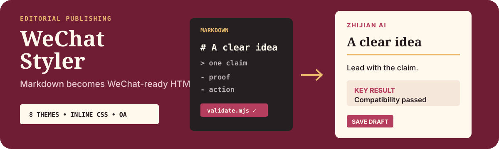

# WeChat Styler

<p align="center">
  
</p>

<p align="center"><strong>Turn Markdown into paste-ready WeChat HTML with crafted themes, deterministic validation, and zero external CSS.</strong></p>

<p align="center"><a href="./README.zh-CN.md">简体中文</a> · <a href="https://github.com/zjp1997720/zhijian-skills/tree/main/skills/wechat-styler">Canonical source</a></p>

Use it when an article is finished in Markdown and needs a stable, branded, paste-ready WeChat layout.

## Agent Install

```bash
npx skills add zjp1997720/zhijian-skills -g -a codex --skill wechat-styler -y
```

Works with any agent runtime that loads SKILL.md (Codex, Claude Code, OpenCode, etc.).

## Requirements

- Node.js 18+
- `marked`, `js-yaml`, `tinyglobby` (auto-installed by the skill runtime or `npm install`)
- Direct WeChat editor injection additionally requires OpenCLI, a connected Chrome profile, and an explicit `--profile` or `OPENCLI_PROFILE` value.

## What It Does

- **Markdown → WeChat HTML in one step.** All styles inlined, all backgrounds solid hex, paste straight into the editor — no format loss.
- **8 themes with real typographic personality.** Not color swaps. `magazine-ink` is a classic editorial layout; `magazine-indigo` is a research column with uppercase headings; `magazine-forest` is a field note with centered kaishu titles. Each theme has its own heading structure, quote style, list marker, and code block.
- **Optional component layer (`--components`).** 8 structured expressions (keyquote, inline highlight, note, warning, steps, flow, compare, timeline) for visualizing comparisons, flows, history, and key points. Off by default — pure markdown rendering for 90% of cases; opt in when you need structured presentation. Layout components use section + flex; dense matrices remain Markdown tables when they communicate better.
- **Deterministic compatibility gate.** `validate.mjs` scans the output for everything WeChat strips (`<style>`, `class`, `rgba()`, `position:fixed`, `@media`…) and prints a line-numbered report. The rules are enforced by script, not by the model remembering them.
- **Recoverable WeChat editor publishing.** The OpenCLI injector syncs body content, metadata, and the cover while recognizing qlogo/qpic transfer states. When the type=77 body-cover picker fails, `--cover-file` uploads, selects, and crops a local cover automatically. Both success and failure produce token-redacted JSON reports.
- **Placeholder mechanism.** Write `【插入:screenshot】` on its own line while images aren't ready; it renders as a dashed placeholder box. Replace it with a normal Markdown image link when the asset lands.

## How It Works

Three pieces, each with one job:

1. **`scripts/convert.mjs`** — parses Markdown via `marked`, applies a theme-specific renderer (6 renderer presets backing 8 themes), emits fully inlined HTML.
2. **`scripts/components.mjs`** — optional component layer (8 structured expressions, enabled with `--components`).
3. **`scripts/validate.mjs`** — scans the output against WeChat compatibility rules (5 ERROR classes, 3 WARN classes). Runs as a soft gate inside convert, or standalone with exit codes for CI.
4. **`themes/*.yaml`** — one file per theme. Colors, fonts, type scale, rhythm, block style. Add a theme by dropping in a new YAML; no code change needed.

Use the stable publishing mode to inject directly into an open WeChat editor:

```bash
node scripts/inject-to-wechat.mjs article_wechat.html \
  --reuse-current \
  --title "Article title" \
  --summary "Share summary" \
  --cover-file /path/to/local-cover.jpg \
  --save-draft \
  --report /tmp/wechat-publish-report.json
```

See `skills/wechat-styler/references/opencli-injection.md` for the cover state machine, save evidence, and recovery table.

Codex's built-in Chrome Browser is not the current injection backend: its safety policy can reject `mp.weixin.qq.com/cgi-bin/appmsg` before DOM access and forbids a CDP workaround. The skill keeps OpenCLI as the portable publishing path for Codex and other agents.

The design choice that matters: **themes are YAML parameters, not heavy component libraries.** This keeps the skill light, stable across models, and easy to extend. When a theme needs structural difference (like the 5 magazine variants), the renderer branches on `magazine_variant` — same script, different layout personality.

## Example Requests

```
Convert this article to WeChat HTML with the magazine-ink theme:
$wechat-styler path/to/article.md --theme magazine-ink

Batch convert a folder:
$wechat-styler "articles/*.md" --theme kami

Validate an existing HTML file:
$wechat-styler Then run: node scripts/validate.mjs path/to/output.html
```

## The Brand Theme Question

The default theme `zhijian` is the author's own brand theme (warm parchment + terracotta accent + ink-blue structure, derived from a brand design system; v3 uses an LXGW WenKai display stack for headings, a screen sans stack for body text, and a short ink line with a clay dot to close the article). It's included as a **worked example** of how to encode a brand system into a skill — not as a product recommendation.

To make it yours: copy `themes/zhijian.yaml`, change the colors, fonts, and `top_label`, give it your name. That's the whole branding step.

## Repository Layout

```text
.
├── README.md
├── README.zh-CN.md
├── assets/readme/hero.svg
├── LICENSE
└── skills/wechat-styler/
    ├── SKILL.md                 # Agent-facing workflow
    ├── agents/openai.yaml       # Agent UI metadata
    ├── scripts/                 # Conversion, components, validation
    └── themes/                  # Eight YAML themes
```

## Design Notes

- **Restraint over decoration.** Themes lean on whitespace, hairline rules, and typography — not cards, ribbons, or keyword underlines. The visual identity is "quiet and trustworthy," not "loud and flashy."
- **Compatibility is a script, not a hope.** Every rule in the validation gate exists because WeChat's editor actually strips or breaks it. The gate runs on every convert.
- **YAML themes, not component libraries.** Adding a theme shouldn't require touching code. Structural personality lives in the renderer's variant branching; surface personality lives in YAML.

## License

MIT — see [LICENSE](../../../skills/wechat-styler/LICENSE).
